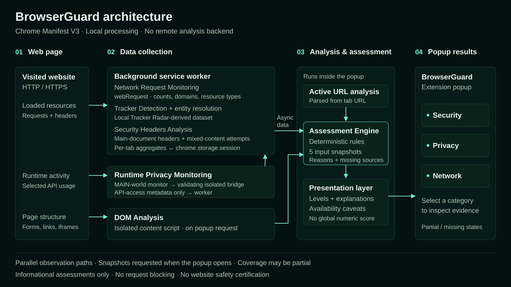

# BrowserGuard

## Overview

BrowserGuard is a Chrome Manifest V3 extension that helps you understand the
observable security, privacy, and network signals of the website you are visiting.
It inspects page structure, request metadata, selected response headers, and
selected browser API usage, then presents three independent assessments.

Analysis runs locally in your browser, using a bundled tracker and entity dataset.
There is no remote analysis backend. BrowserGuard is an observation tool: it does
not block requests or content, remove malware, or certify that a website is safe.
It is not a validated phishing detector.

## How BrowserGuard Works



[Open the full-size architecture diagram](docs/images/browserguard-architecture.svg).
The diagram shows data flowing toward the interface; snapshot requests and
responses use asynchronous Chrome extension messaging.

1. **Visit a web page.** While supported HTTP/HTTPS pages load and run, the
   service worker observes requests and main-document response headers. A
   MAIN-world content script observes selected runtime API calls.
2. **Collect observable signals.** The service worker aggregates network data,
   matches cross-origin request domains against the local tracker dataset,
   resolves entity relationships, and analyzes selected security headers and
   mixed-content request attempts. The runtime monitor emits limited metadata
   through a validating isolated-world bridge to the service worker.
3. **Open BrowserGuard.** The popup parses the active URL, requests network,
   runtime, and security snapshots from the service worker, and requests a fresh
   DOM analysis directly from the page content script. It checks the active tab
   identity again before accepting the collected result.
4. **Assess the available evidence.** The popup invokes the local, deterministic
   rule-based Assessment Engine with those five inputs. The engine returns
   separate Security, Privacy, and Network results, including reasons and
   missing-source information. These are observations, not a global safety score.
5. **Read the results.** The popup presentation layer renders three category
   cards and their detailed evidence. Collection paths run independently, so
   snapshots may be partial or unavailable rather than one complete, synchronized
   scan.

The engine runs in the popup, not in a remote service or the background worker.
Per-tab worker state is retained in `chrome.storage.session` so it can survive
worker suspension; it is reset on observed main-frame requests and removed when
Chrome reports a tab closing.

## Features

| Category | What BrowserGuard observes |
| --- | --- |
| **Security Analysis** | HTTP/HTTPS and URL indicators; password-form destinations; link mismatches; iframe configuration; selected CSP, HSTS, content-type, referrer, permissions, and anti-framing headers; mixed-content request attempts. |
| **Privacy Analysis** | Cross-origin requests matching locally bundled tracking-associated domains, plus selected Canvas, WebGL, audio, navigator, and screen API usage indicators. Runtime output values and form field values are not collected. |
| **Network Analysis** | Request counts, resource types, cross-origin domains, and same-entity, confirmed external, or unresolved ownership relationships. The Network assessment describes confirmed external exposure, not maliciousness. |

The popup also includes explanations, supporting evidence, a glossary, a short
introduction, and light/dark appearance preferences.

## Installation

No build, package installation, API key, or backend configuration is required.
The repository already includes the runtime scripts and generated dataset.

1. Download and extract this repository, or clone it with Git.
2. Open `chrome://extensions` in Google Chrome.
3. Enable **Developer mode**.
4. Select **Load unpacked**.
5. Select the extension root folder containing `manifest.json` (not its parent
   folder or the `popup` subfolder).
6. Confirm that **BrowserGuard** appears in the extension list without loading
   errors. Optionally pin it using Chrome’s extensions menu.

After installation or reloading the extension, reload the website you want to
inspect. This lets request/header collection observe its load and installs the
runtime monitor at `document_start`. Node.js is needed for development scripts
and automated tests, not for loading the extension.

## How to Use

1. Open an HTTP or HTTPS website, and allow it to load.
2. Open **BrowserGuard** from Chrome’s extensions toolbar/menu. Complete or skip
   the introduction if it appears.
3. Check the displayed domain and the **Security**, **Privacy**, and **Network**
   cards. Security describes observable connection/page configuration signals;
   Privacy describes privacy-related activity; Network describes external
   exposure in the observed traffic.
4. Interpret **Low**, **Moderate**, and **High** within each category. They are
   independent descriptive levels, not a safety certificate. A favorable state
   does not guarantee a safe or trustworthy site. A dash (**—**) means the
   available evidence is insufficient; **Partial data** marks incomplete inputs.
5. Select a category card to open its evidence directly. **All details** expands
   or collapses the detailed area; its Overview, Security, Privacy, and Network
   tabs retain metrics, findings, and observations. Supporting evidence can be
   expanded where available.
6. To read newer observations, close and reopen the popup: each opening requests
   current snapshots and a new DOM analysis. There is no dedicated refresh
   button or continuous popup refresh. Reload the website to start a new page
   observation; requests missed before the extension was loaded cannot be
   reconstructed.

The domain is shortened visually when necessary; hover it to see the full value.
Category buttons support keyboard activation, and detail tabs support the arrow
keys, Home, and End. The header provides help and an appearance toggle.

## Privacy & Permissions

Collected analysis signals are processed locally and are not sent to an analysis
API, telemetry service, or BrowserGuard backend. Tracker matching uses bundled
data; the extension runtime does not contact DuckDuckGo. The popup may load the
favicon URL reported by Chrome for the active tab; it does not use a separate
favicon lookup service.

BrowserGuard does use local Chrome storage:

- `chrome.storage.session`: temporary per-tab network, runtime privacy, and
  web-security state, including page/domain information needed for analysis.
- `chrome.storage.local`: appearance preference and introduction-completion
  preference. These may persist across browser restarts.
- `chrome.storage.sync` is not used.

| Permission / access | Purpose |
| --- | --- |
| `tabs` | Identify the active tab and its URL. |
| `scripting` | Inject the page-analysis content script on supported pages if its listener is missing. |
| `storage` | Retain temporary per-tab analysis state and local UI preferences. |
| `webRequest` | Observe request metadata and selected main-document response headers, without blocking requests. |
| `http://*/*`, `https://*/*` host access | Run content scripts and observe supported visited websites across HTTP and HTTPS. |

BrowserGuard does not read passwords or form field values, request/response
bodies, cookies, or Authorization headers. Runtime API observations retain access
metadata rather than fingerprint output values. See the [privacy policy](PRIVACY.md)
for the broader data-handling description. Its local-storage description mentions
the theme preference; the current UI also stores introduction completion.

## Limitations

- BrowserGuard is not an antivirus, firewall, or vulnerability scanner. It does
  not automatically block content, tracking, or network requests, and does not
  certify that a website is safe, legitimate, or free of malicious behavior.
- Observations can be incomplete, unavailable, or misleading. A missing signal
  is not evidence of zero activity; loading timing, extension reloads, and browser
  restrictions affect coverage. Chrome internal pages and Chrome Web Store pages
  cannot be analyzed like ordinary websites.
- Tracker detection covers matching cross-origin requests in the local dataset.
  It cannot identify all tracking. First-party-hosted tracking and CNAME
  cloaking may be missed; DNS resolution/uncloaking is not implemented.
- A dataset match does not prove that an individual request tracked the user.
  Third-party does not mean malicious, and same-entity does not mean safe or
  privacy-preserving. Entity metadata coverage is incomplete.
- Request grouping uses a registrable-domain heuristic, not a complete Public
  Suffix List. The UI’s cross-origin label refers to this domain grouping, not
  necessarily the browser’s exact scheme/host/port origin boundary.
- Runtime monitoring covers selected APIs, and page scripts can spoof the event
  bridge. Legitimate graphics, audio, and feature detection can trigger these
  observations. Co-occurring API accesses do not prove fingerprinting or intent.
- Content scripts are configured for the top frame, not every nested frame.
  DOM analysis inspects iframe elements; it does not recursively inspect all
  embedded documents.
- Security-header parsing is lightweight. Missing hardening headers do not alone
  establish a vulnerability. Mixed-content request attempts do not prove that
  insecure resources loaded or executed, and redirect chains are not fully
  reconstructed.
- Cookie analysis, permission monitoring, WHOIS/domain reputation, and
  malware/phishing blacklists are not implemented.

## Technical Reference

The following sections describe the existing collectors and assessment semantics.
For the rule table, fixtures, and calibration limits, see the
[assessment calibration report](ASSESSMENT_CALIBRATION.md). The
[earlier popup redesign report](POPUP_REDESIGN_V2.md) records an earlier UI
iteration; the usage instructions above describe the current interface.

<details>
<summary>Collector, dataset, and assessment reference</summary>

## Network Activity

Network Activity describes what the page communicates with. It keeps state per
tab and records:

- total observed requests;
- first-party requests;
- cross-origin requests, stored internally as third-party requests;
- distinct cross-origin hostnames;
- request counts by Chrome resource type;
- request counts per cross-origin hostname.

First-party vs third-party classification uses a centralized registrable-domain
heuristic so that hosts such as `www.example.com` and `static.example.com` are
normally treated as the same site. This is not a complete Public Suffix List
implementation, so uncommon multi-label public suffixes may still be grouped
incorrectly.

## Tracker Detection

Tracker Detection is separate from Network Activity:

- Network Activity observes requests.
- Tracker Detection identifies request hostnames whose parent domain appears in
  the local Tracker Radar-derived dataset.

A third-party domain is not automatically a tracker or malicious. BrowserGuard
labels a domain as tracking-associated when its Tracker Radar domain-level
metadata contains tracking-related categories used by BrowserGuard.

A tracking-associated domain match does not prove that the individual request is
performing tracking. No tracking-associated domain match does not imply the
absence of tracking.

The matching runs locally inside the extension. BrowserGuard does not send
visited URLs, hostnames, request data, history, cookies, request bodies,
Authorization headers, or POST data to external services.

BrowserGuard performs analysis locally. Some per-tab aggregate state, including
page/domain information required by the analysis, may be temporarily stored in
`chrome.storage.session`. This data is not transmitted to external services by
the extension.

## Tracker Dataset

The current dataset is a generated local compact dataset in
`data/tracker-data.js`.

- Source: DuckDuckGo Tracker Radar
- Source repository: [DuckDuckGo Tracker Radar](https://github.com/duckduckgo/tracker-radar)
- Source license: Creative Commons Attribution-NonCommercial-ShareAlike 4.0
  International
- Generated at: 2026-09-28T10:21:25.235Z
- Source ref: `main`
- Region: `US`
- Current tracker domains: 948
- Current entity domains: 38,370
- Generated dataset size: about 1.44 MB
- Structure: compact local arrays for tracker domains, normalized categories,
  owner/prevalence metadata, and entity-domain ownership mappings

Categories currently used:

- Analytics
- Advertising
- Social

The update pipeline is `node scripts/update-tracker-radar.js`. That developer
script downloads DuckDuckGo Tracker Radar source files and regenerates the local
dataset. The extension runtime never contacts DuckDuckGo and does not require
additional Chrome permissions.

Tracker Radar categories are normalized into user-facing BrowserGuard
categories. BrowserGuard does not infer tracker category from a domain name.
The classification is domain-level and may be derived from evidence about
specific resources or observed uses of that domain in Tracker Radar.

## Domain Matching

Tracking-associated domain matching is domain-bound:

- `example.com` matches `example.com`;
- `tracker.example.com` matches `example.com`;
- `notexample.com` does not match `example.com`;
- `example.com.evil.test` does not match `example.com`.

The matcher uses suffix lookup over hostname labels and a `Map` of
tracking-associated domains. It avoids substring matching such as
`hostname.includes(domain)`.

## Entity-aware Third-party Classification

Raw first-party and third-party metrics retain their registrable-domain
grouping. In the popup, these are presented as first-party and cross-origin so
they are not confused with independent external organizations:

- First-party: the request registrable domain matches the page registrable
  domain.
- Third-party: the request registrable domain differs from the page registrable
  domain.

BrowserGuard also computes a separate entity relationship layer using Tracker
Radar entity-domain metadata:

- `same-entity-third-party`: different registrable domains, but both domains
  map to the same known entity.
- `external-third-party`: different registrable domains and both entities are
  known and different.
- `unknown-third-party`: one or both entities are unknown.

Unknown is conservative: missing entity data is not treated as external and is
not treated as trusted. Same-entity does not imply safe or privacy-preserving.
Third-party does not imply tracker or malicious.

The Network Assessment uses confirmed external third-party activity for
escalation, while the raw UI counters still show all cross-origin requests.
Tracking evidence remains independent: a same-entity third-party can still be
tracking-associated if it appears in Tracker Radar.

## Runtime Privacy / Fingerprinting Indicators

Runtime Privacy observes selected privacy-sensitive APIs from page scripts.
Because Chrome content scripts normally run in an isolated world, BrowserGuard
installs `content/runtime-monitor.js` in the page `MAIN` world at
`document_start`. That monitor wraps selected APIs and emits schema-limited
`CustomEvent` messages to `content/runtime-bridge.js`, which runs as a normal
isolated content script.

The bridge validates each event and forwards only accepted event metadata to the
background service worker. The page can potentially dispatch fake events, so the
bridge and background treat this channel as untrusted. Events cannot request
privileged actions and cannot access `chrome.*`; they only describe an observed
category and API/property name.

Monitored categories:

- Canvas: `HTMLCanvasElement.toDataURL`, `HTMLCanvasElement.toBlob`,
  `CanvasRenderingContext2D.getImageData`
- WebGL: `WebGLRenderingContext.getParameter`,
  `WebGL2RenderingContext.getParameter`, `getExtension`, including observation
  of `WEBGL_debug_renderer_info` access and unmasked vendor/renderer parameter
  requests
- Audio: `AudioContext`, `OfflineAudioContext`
- Device Information: `navigator.hardwareConcurrency`,
  `navigator.deviceMemory`, `navigator.languages`, `navigator.platform`,
  `navigator.userAgent`, `navigator.maxTouchPoints`
- Screen Information: `screen.width`, `screen.height`, `screen.availWidth`,
  `screen.availHeight`, `screen.colorDepth`, `screen.pixelDepth`

Runtime Privacy stores only that an API/property was accessed. It does not store
canvas output, images, audio output, GPU renderer/vendor strings, user agent
values, screen resolution, CPU count, device memory, or other fingerprint values.

When at least three runtime categories are observed, the popup notes that multiple
API categories were observed. This descriptive note is separate from the engine’s
correlation of specific sensitive surfaces; API access alone does not establish
fingerprinting.

Runtime monitor limitations:

- Existing tabs may need a refresh after extension load for the `document_start`
  MAIN-world monitor to be installed early.
- Pages can spoof bridge events, so this signal is observational rather than
  authoritative.
- Browser APIs that are non-configurable or absent are skipped safely.
- Legitimate graphics, audio, feature detection, or responsive design code can
  trigger API usage indicators.
- The monitor wraps selected APIs to observe access while forwarding calls to
  their original implementations. It does not block calls, spoof outputs, or
  randomize fingerprint values.

## Web Security Configuration

Web Security Configuration analyzes the main document response and related page
configuration. It is an observation module, not a vulnerability scanner and not
a risk score.

BrowserGuard currently checks:

- HTTPS connection status
- `Content-Security-Policy`
- `Content-Security-Policy-Report-Only`
- `Strict-Transport-Security`
- `X-Content-Type-Options`
- `Referrer-Policy`
- `Permissions-Policy`
- anti-framing configuration through CSP `frame-ancestors` and
  `X-Frame-Options`
- mixed content requests observed by the existing Network Activity collector
- iframe security metrics from Page Analysis

CSP parsing is intentionally lightweight. It reports technical observations such
as wildcard sources, `'unsafe-inline'`, and `'unsafe-eval'`, but these
observations do not automatically imply that the page is vulnerable.

HSTS parsing extracts `max-age`, `includeSubDomains`, and `preload`. A `max-age`
below 180 days is shown as a configuration observation. Lack of `preload` is not
treated as a problem.

Mixed content detection counts HTTP subresource requests observed from an HTTPS
main page. It uses the request URL seen by `webRequest.onBeforeRequest`; redirect
chains and final post-redirect URLs are not fully reconstructed in this version.

Iframe security distinguishes total iframes, third-party iframes, sandboxed
iframes, third-party iframes without sandbox, sandbox tokens, and HTTP iframes
inside HTTPS pages. An unsandboxed iframe is reported as evidence only; it is
not automatically labeled as a vulnerability.

BrowserGuard deliberately does not store cookies, `Set-Cookie`, Authorization
headers, response bodies, request bodies, POST data, or unrelated HTTP headers.
Absence of a security header does not automatically mean that the site has a
vulnerability.

## Assessment Engine

The Assessment Engine is implemented in
`modules/assessment/assessment-engine.js`. It is a deterministic, UI-independent
module with no DOM or Chrome API dependency. The popup passes the snapshots that
BrowserGuard already collects and renders separate Security, Privacy, and Network assessment cards.

Input snapshot:

- `urlAnalysis`: structured URL indicators from the popup URL parser.
- `pageAnalysis`: DOM/form/link/iframe metrics from the content script.
- `networkActivity`: request counters, third-party domains, and tracker counts.
- `runtimePrivacy`: selected fingerprinting-related runtime API indicators.
- `webSecurity`: HTTPS, selected security headers, mixed content, and iframe
  configuration.

Output shape:

- `dataStatus`: `complete` or `partial`.
- `missingSources`: ordered list of unavailable input sources.
- `security`, `privacy`, `network`: independent dimension objects with
  `level`, `summary`, `reasons`, `positiveSignals`, `contributingFindings`,
  `informationalObservations`, and `uncertainties`.

BrowserGuard intentionally does not calculate a global numeric score. The three
dimensions are separate so that security hardening, privacy-related activity,
and external network exposure are not collapsed into one ambiguous number.

Security levels:

- `no-major-issues`
- `observations`
- `attention`

Security displays Low (`no-major-issues`), Moderate (`observations`), or High
(`attention`). HTTP main pages, HTTP password-form targets, and active mixed
content request attempts produce High. Other mixed content attempts, HTTP iframe
markup, external password-form targets, and explicitly suspicious link mismatches
produce Moderate. Moderate findings do not accumulate into High. Missing or
permissive hardening headers, broad URL heuristics, ordinary mismatched links,
hidden iframes, and unsandboxed third-party iframes are informational observations.
They remain visible and do not escalate the level. A request attempt does not
confirm successful insecure loading or execution.

Privacy levels:

- `low-activity`
- `moderate-activity`
- `elevated-activity`

Tracking-associated domain activity becomes moderate at 2 matched domains or
10 associated requests, and elevated at 5 matched domains, or at 30 associated
requests when at least 2 matched domains are involved. Tracker Radar categories
such as Analytics, Advertising, and Social are descriptive evidence only; they
are not weighted.
Runtime privacy activity is considered correlated when at least two specific
sensitive surfaces co-occur: Canvas readback/export, unmasked WebGL hardware
queries, or OfflineAudioContext construction. Navigator/Screen access, generic
WebGL parameters, and ordinary AudioContext construction remain informational.
A single sensitive surface also remains informational. Co-occurrence does not
establish a common script or prove fingerprinting. Moderate tracker-associated
activity combined with correlated sensitive surfaces produces High Privacy.
A domain match associates requests with the dataset domain, without proving
that individual requests performed tracking. Dataset categories remain descriptive.

Network levels:

- `low-third-party-activity`
- `moderate-third-party-activity`
- `high-third-party-activity`

Only confirmed external attribution contributes to the Network level. Unknown
attribution remains visible as uncertainty; it is neither confirmed external nor
first-party. Moderate requires a ratio of at least 25% and at least 5 external
requests, at least 5 external domains and 5 external requests, or at least 20
external requests with a ratio of at least 10%. High retains the previous
thresholds: at least 50% and 10 external requests; at least 15 external domains
with 15 external requests or 30 total requests; or at least 75 external requests
with a ratio of at least 25%. These are exposure thresholds, not maliciousness
thresholds. See [the calibration report](ASSESSMENT_CALIBRATION.md) for the
before/after rule table, historical fixture results, sensitivity changes, and limits.

`high-third-party-activity` means elevated external third-party exposure. It
does not mean high security risk, a dangerous website, or an unsafe website.

Mismatched visible links are reported when visible link text looks like a URL or
domain but points to a different hostname. One isolated mismatch is not treated
as evidence of phishing. Multiple or proportionally significant mismatches remain
informational. A mismatch explicitly classified as suspicious by the collector
(displayed URL pointing to a different external host) produces Moderate Security.

The engine avoids double counting by keeping related URL heuristics in one
reason, keeping tracker classification in Privacy, and keeping third-party
volume in Network. Missing data is reported through `dataStatus` and
`missingSources`; unavailable data is never treated as a positive signal.
Missing Network Activity or Runtime Privacy data also adds a
`privacy-data-incomplete` informational reason so incomplete privacy assessment
does not look like observed zero activity.

Each non-baseline assessment includes structured reasons such as:

```json
{
  "id": "known-trackers",
  "severity": "medium",
  "message": "Activity from tracking-associated domains was observed",
  "evidence": {
    "trackerDomainCount": 2,
    "trackerRequests": 12,
    "categories": ["Analytics"]
  }
}
```

Assessment limitations:

- It is heuristic and observational, not a vulnerability scanner.
- It does not certify that a site is safe or unsafe.
- It uses only BrowserGuard's existing local snapshots.
- Incomplete snapshots reduce confidence and are surfaced explicitly.
- The popup presents compact summaries; detailed findings remain available by category.


</details>

## Project Structure

```text
browserguard/
├── manifest.json               # MV3 entry points and permissions
├── background/                 # Request/header collection and per-tab state
├── content/                    # DOM analyzer, MAIN-world monitor, isolated bridge
├── modules/
│   ├── assessment/              # Pure, rule-based Assessment Engine
│   ├── network/                 # Entity relationship resolution
│   ├── security/                # Selected security-header analysis
│   └── trackers/                # Domain-bound local tracker matching
├── popup/                      # UI, snapshot orchestration, presentation, help
├── data/                       # Bundled dataset and generation metadata
├── docs/                       # Architecture diagram and release documentation
├── presentation/               # Historical university presentation (.tex/PDF/assets)
├── scripts/                    # Dataset updater and Chrome rendering checks
├── test-pages/                 # Manual DOM/runtime/security fixtures
├── tests/                      # Automated tests and historical fixture
└── tools/website-testing/       # Isolated benchmark framework, corpus and analysis
    ├── benchmark1000/          # Frozen collection protocol and offline tooling
    ├── controlled-validation/  # Synthetic local scenarios and historical evidence
    ├── datasets/               # Licensed public corpus and source provenance
    ├── analysis/               # Python code and versioned aggregate output
    ├── publication/benchmark1000/ # Self-contained aggregate publication bundle
    └── runs/                   # Local raw records/profiles metadata; ignored by Git
```

The [university presentation](presentation/README.md) is historical material, not
the current test report. No separate university dissertation/report is included.
[Release organization and checks](docs/RELEASE.md) explain what remains local and
which documents are frozen historical evidence. Design notes remain in
[assessment calibration](ASSESSMENT_CALIBRATION.md) and
[popup redesign](POPUP_REDESIGN_V2.md); runtime source is authoritative.

## Final 1,000-site Benchmark

The completed benchmark attempted **1,000 sourced HTTPS URLs**, producing 1,000
valid records, **999 captured assessments**, **787 ok/partial visits**, 132
restrictions, 80 navigation errors and one popup collection failure. There were
30 timeout cases, overlapping those outcomes. An assessment from an error or
restriction page does not establish that the intended site was observed.

The final audit passed with **239 automated tests**. The production fingerprint
was `0f2c1f20712aa4e76cdd9eaa6f393aeb28f919abe1d1fa01d8f609942e9f1fbc`.
This measures operational collection and observed-signal distributions, not
detector accuracy, phishing detection, or the percentage of safe websites.

- [Benchmark report and limitations](tools/website-testing/BENCHMARK_1000.md)
- [Descriptive comparison with the earlier 100-site run](tools/website-testing/BENCHMARK_COMPARISON.md)
- [Statistical report, six PNG/SVG figures and aggregate CSVs](tools/website-testing/analysis/output/benchmark1000/BENCHMARK_ANALYSIS.md)
- [Self-contained publication bundle](tools/website-testing/publication/benchmark1000/README.md)
- [Corpus provenance and licenses](tools/website-testing/datasets/DATASET_1000.md)
- [Frozen protocol, resource limits and resume commands](tools/website-testing/benchmark1000/README.md)

Raw browsing records and checkpoints remain local in the ignored `runs/`
directory. Some historical report links refer to that local evidence and are not
available in a fresh clone. Aggregate reports and figures remain versioned.
The 100-site and 1,000-site versions and samples differ; their comparison is
descriptive rather than a controlled A/B experiment.

## Development & Tests

For real-browser tests across 10, 100, or 1,000 websites, see the separate
[automated website testing framework](tools/website-testing/README.md). It uses
isolated Playwright Chromium profiles, captures real extension results, and
produces local JSON/CSV/HTML reports without changing extension behavior.

Regenerate the self-contained vector diagram with Python 3 (standard library only):

```bash
python3 docs/generate-architecture.py
```

Run all local automated tests with a recent Node.js version supporting `node:test`:

```bash
node --test tests/*.test.js
```

Run the remaining offline suites from the repository root (Node 22+;
Python 3.11+ and the analysis dependencies):

```bash
npm ci --prefix tools/website-testing
python3 -m venv tools/website-testing/analysis/.venv
tools/website-testing/analysis/.venv/bin/python -m pip install -r tools/website-testing/analysis/requirements-lock.txt
node --test tools/website-testing/*.test.cjs
node --test tools/website-testing/controlled-validation/*.test.cjs
node --test tools/website-testing/benchmark1000/*.test.cjs
tools/website-testing/analysis/.venv/bin/python -m unittest discover -s tools/website-testing/analysis -p 'test_*.py'
python3 -m unittest discover -s tools/website-testing/controlled-validation -p 'test_*.py'
python3 -m unittest discover -s tools/website-testing/benchmark1000 -p 'test_*.py'
```

These suites do not revisit the 1,000 websites. Browser installation and live
collection are separate, explicitly invoked framework operations. Do not run the
benchmark finalizer merely to check a release: it regenerates derived artifacts.

Check the popup layout and interactions in a locally installed Chrome/Chromium:

```bash
node scripts/check-popup-layout.js
```

Set `BROWSERGUARD_CHROME` to the browser executable if the default macOS Chrome
path is unsuitable. The script uses mocked Chrome APIs with the real popup code,
checks multiple data states, keyboard interaction, and light/dark layouts at
400, 432, and 440 px, and writes screenshots/DOM reports to a temporary directory.
A real loaded-extension check is still needed for live MV3 messaging and browser
integration. Manual fixtures are in [test-pages](test-pages/).

To regenerate the bundled tracker/entity dataset during development:

```bash
node scripts/update-tracker-radar.js
```

This optional developer script downloads upstream Tracker Radar files; it is not
part of installation or runtime analysis. Dataset metadata is recorded in
[data/generated/tracker-radar-metadata.json](data/generated/tracker-radar-metadata.json).

## License & Attribution

BrowserGuard source code is distributed under the [MIT License](LICENSE).
The bundled, transformed DuckDuckGo Tracker Radar dataset has a separate
**CC BY-NC-SA 4.0** license; the source-code license does not replace its terms.
See [Third-Party Notices](THIRD_PARTY_NOTICES.md) for attribution, transformation
details, and upstream license references. DuckDuckGo does not endorse BrowserGuard.
The benchmark corpus separately contains Wikidata structured data (CC0) and
Curlie directory selections (CC BY 3.0); their attribution and provenance are in
the same notices and the corpus documentation. They are not runtime detectors.
