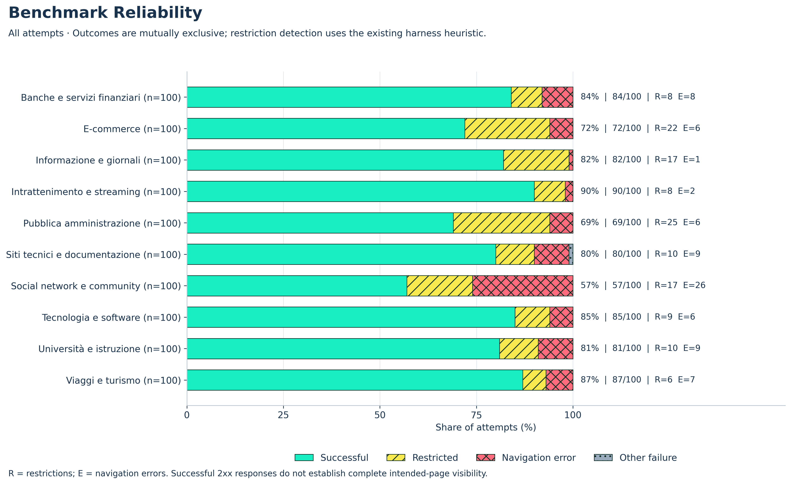
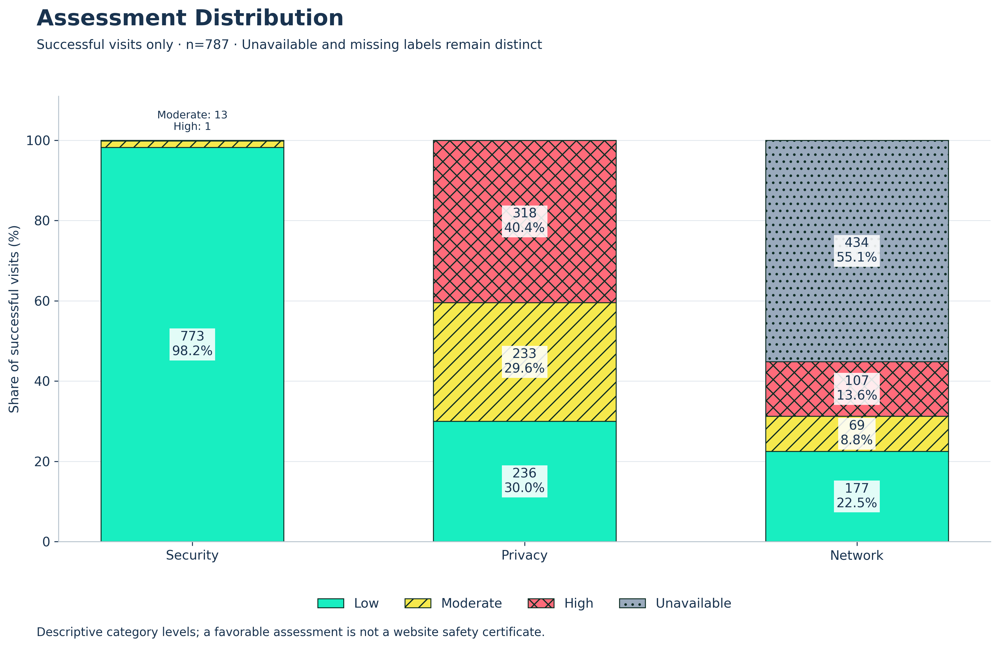
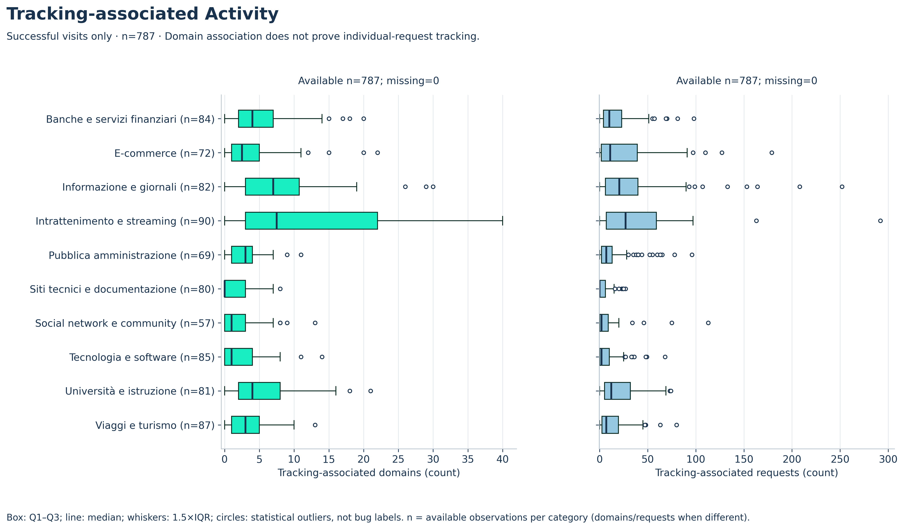
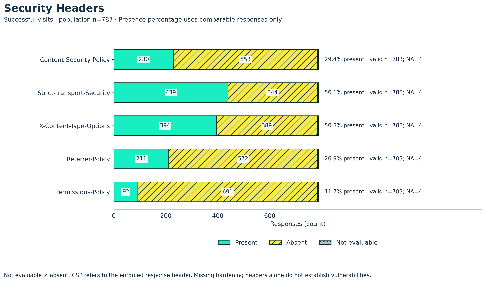
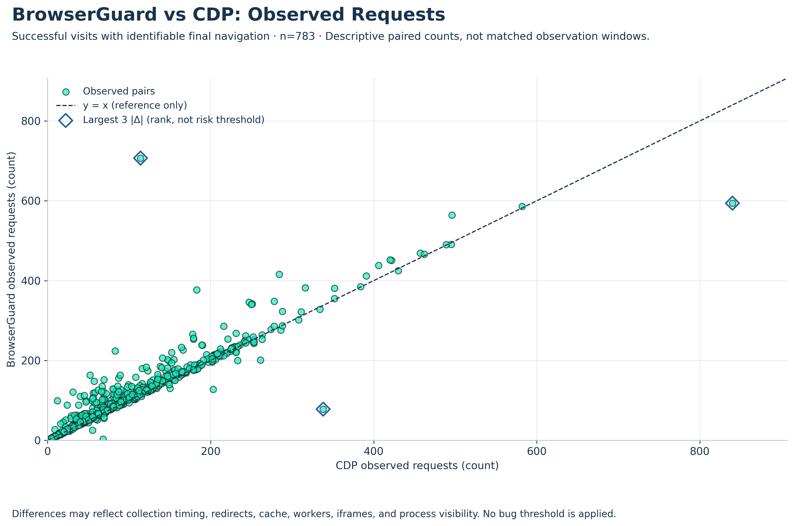
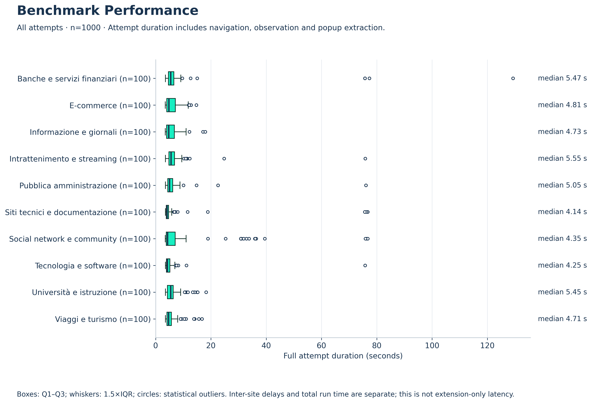

# BrowserGuard — Statistical Benchmark Analysis

## 1. Executive summary

Ricalcolati **1000 tentativi**, **999 assessment acquisiti** e **787 visite classificate come riuscite (78.70%)** dai record originali. Rilevate 132 restrizioni, 80 errori di navigazione e 30 timeout. La durata media del singolo tentativo è 6.90 s, la mediana 4.83 s.

Le 515 segnalazioni originali e le — segnalazioni della revisione sono popolazioni distinte. I falsi positivi del validator documentati sono —. Bug dell'estensione documentati nella revisione: —; bug del framework documentati: —. Questi ultimi sono annotazioni di revisione verificate nei file disponibili, non nuovi bug confermati dall'analisi statistica.

## 2. Dataset e popolazioni

Campione pubblico ragionato, non casuale e non rappresentativo di tutto il Web. Le categorie e le loro dimensioni sono riportate nella [tabella di affidabilità](tables/reliability_by_category.csv). Gli assessment acquisiti su blocchi o pagine d'errore non rendono valida la navigazione alla homepage prevista.

La popolazione principale di assessment, tracking e header comprende i record con stato `ok` o `partial`, senza errore di navigazione, restrizione rilevata o errore di estrazione. Include 2 risposte HTTP 202 nell'intero benchmark: il criterio del framework non garantisce la visualizzazione integrale della pagina prevista. Gli assessment parziali nell'intero dataset sono 75; i dati mancanti restano mancanti. I grafici di affidabilità e performance comprendono invece tutti i tentativi.

## 3. Metodologia statistica

Statistiche descrittive calcolate con Pandas: media, mediana, minimo, massimo, deviazione standard **campionaria** (`ddof=1`), quartili e percentili con interpolazione lineare. La deviazione standard non è stimata per meno di due valori. Percentuali calcolate sui denominatori dichiarati; un denominatore nullo produce un dato non valutabile, mai 0% automatico. I boxplot usano Q1–Q3, mediana e baffi a 1.5×IQR: gli outlier sono statistici, non etichette di bug.

Nessuna soglia di rischio, classificazione aggiuntiva, precision, recall, F1-score o accuracy dei detector: manca un ground truth indipendente. Non si calcolano inferenze di popolazione da questo campione di convenienza. Gli stessi input e le stesse versioni delle librerie producono gli stessi artefatti, senza timestamp dinamici nei grafici.

## 4. Affidabilità del benchmark

| category | n | successful | restricted | navigation_error | other_failure | success_pct |
| --- | --- | --- | --- | --- | --- | --- |
| Banche e servizi finanziari | 100 | 84 | 8 | 8 | 0 | 84 |
| E-commerce | 100 | 72 | 22 | 6 | 0 | 72 |
| Informazione e giornali | 100 | 82 | 17 | 1 | 0 | 82 |
| Intrattenimento e streaming | 100 | 90 | 8 | 2 | 0 | 90 |
| Pubblica amministrazione | 100 | 69 | 25 | 6 | 0 | 69 |
| Siti tecnici e documentazione | 100 | 80 | 10 | 9 | 1 | 80 |
| Social network e community | 100 | 57 | 17 | 26 | 0 | 57 |
| Tecnologia e software | 100 | 85 | 9 | 6 | 0 | 85 |
| Università e istruzione | 100 | 81 | 10 | 9 | 0 | 81 |
| Viaggi e turismo | 100 | 87 | 6 | 7 | 0 | 87 |

La figura usa esiti mutuamente esclusivi: successo, errore di navigazione, restrizione, altro fallimento. I contatori di timeout, parzialità e messaggi d'errore possono sovrapporsi ad altri esiti; non vanno sommati come popolazioni disgiunte. [Tabella riepilogativa completa](tables/reliability_summary.csv).

## 5. Distribuzione degli assessment

| dimension | Low | Moderate | High | Unavailable | Missing |
| --- | --- | --- | --- | --- | --- |
| security | 773 | 13 | 1 | 0 | 0 |
| privacy | 236 | 233 | 318 | 0 | 0 |
| network | 177 | 69 | 107 | 434 | 0 |

Il denominatore principale è 787 visite riuscite per dimensione. `Unavailable` rappresenta il trattino mostrato dall'interfaccia; `Missing` indica un'etichetta assente. Un Network non valutabile può dipendere dalla copertura dell'attribuzione anche quando gli input sono completi. Low non certifica la sicurezza del sito. Le [frequenze e percentuali globali](tables/assessment_distribution.csv) e le [distribuzioni per categoria](tables/assessments_by_category.csv) includono separatamente anche tutti i tentativi.

## 6. Attività associata al tracking

| metric | n | missing | mean | median | min | max | std_sample | q1 | q3 |
| --- | --- | --- | --- | --- | --- | --- | --- | --- | --- |
| tracker_domains | 787 | 0 | 4.77 | 3 | 0 | 40 | 5.68 | 1 | 6 |
| tracker_requests | 787 | 0 | 18.92 | 7 | 0 | 292 | 29.22 | 1 | 24.50 |

Solo visite riuscite; i contatori mancanti sono esclusi dalle statistiche, non sostituiti con zero. L'associazione di dominio al dataset non prova che ogni richiesta effettui tracking; lo zero non dimostra assenza di tracking. [Statistiche complete per categoria e popolazione](tables/tracking_statistics.csv).

## 7. Header di sicurezza

| header | population_n | present | absent | not_evaluable | valid_denominator | presence_pct_valid |
| --- | --- | --- | --- | --- | --- | --- |
| Content-Security-Policy | 787 | 230 | 553 | 4 | 783 | 29.37 |
| Strict-Transport-Security | 787 | 439 | 344 | 4 | 783 | 56.07 |
| X-Content-Type-Options | 787 | 394 | 389 | 4 | 783 | 50.32 |
| Referrer-Policy | 787 | 211 | 572 | 4 | 783 | 26.95 |
| Permissions-Policy | 787 | 92 | 691 | 4 | 783 | 11.75 |

Un confronto richiede una risposta HTTP(S) finale del documento principale, con URL coincidente con quella osservata, header CDP registrati e presenza BrowserGuard espressa da un booleano. I valori ignoti restano non valutabili. La percentuale è **presenti / (presenti + assenti)**, non presenti / tutti i siti. CSP indica l'header enforced; una policy report-only non è un header CSP enforced. La figura esclude le visite limitate; la [tabella completa](tables/header_presence.csv) include separatamente tutti i tentativi. L'assenza di un header non dimostra automaticamente una vulnerabilità.

## 8. Consistenza delle osservazioni CDP

| measurement | eligible | not_evaluable | agree | disagree | agreement_pct | unit |
| --- | --- | --- | --- | --- | --- | --- |
| protocol | 920 | 80 | 920 | 0 | 100 | document pairs |
| mixed_content | 920 | 80 | 913 | 7 | 99.24 | document pairs |
| header_presence | 4600 | 400 | 4600 | 0 | 100 | header pairs |

Il protocollo è ricalcolato dall'URL della **risposta CDP effettiva confrontabile**, non dal nome del campo `cdpUsesHTTPS` dell'arricchimento, che nel postprocessore precedente era derivato dall'URL finale Playwright. I denominatori sono distinti: header singoli, coppie di documenti per protocollo, coppie di contatori per mixed content. La concordanza non è una misura di accuratezza degli assessment. Nei documenti confrontabili, i casi con tentativi mixed content >0 sono 7 per CDP e 0 per BrowserGuard; una concordanza di zeri non verifica la sensibilità ai casi positivi. I documenti HTTPS osservati da CDP sono 919 su 920: il campione non verifica automaticamente il comportamento su HTTP.

| population | n | missing | mean | median | min | max | different_counts | mean_absolute_delta | max_absolute_delta |
| --- | --- | --- | --- | --- | --- | --- | --- | --- | --- |
| successful | 783 | 4 | 9.85 | 4 | -260 | 593 | 677 | 12.63 | 593 |
| all | 920 | 80 | 7.26 | 3 | -343 | 593 | 763 | 12.47 | 593 |

La differenza è BrowserGuard − CDP. Il grafico usa soltanto visite riuscite con richiesta finale del documento identificabile e due contatori disponibili; le finestre **non sono identiche**. La linea y=x è un riferimento geometrico, non un criterio di correttezza. I tre punti con maggiore differenza assoluta sono evidenziati per rango descrittivo, senza una soglia di bug. Redirect, cache, worker, iframe e differenze di visibilità possono spiegare gli scostamenti. [Concordanze](tables/cdp_agreement.csv) e [differenze richieste](tables/request_differences.csv).

## 9. Performance

| category | n | missing | mean | median | std_sample | p90 | p95 |
| --- | --- | --- | --- | --- | --- | --- | --- |
| All categories | 1000 | 0 | 6.90 | 4.83 | 9.55 | 8.54 | 12.34 |
| Banche e servizi finanziari | 100 | 0 | 9.13 | 5.47 | 17.22 | 8.80 | 12.76 |
| E-commerce | 100 | 0 | 5.83 | 4.81 | 2.53 | 9.60 | 11.49 |
| Informazione e giornali | 100 | 0 | 5.73 | 4.73 | 2.61 | 8.56 | 10.25 |
| Intrattenimento e streaming | 100 | 0 | 6.76 | 5.55 | 7.44 | 7.81 | 10.89 |
| Pubblica amministrazione | 100 | 0 | 6.25 | 5.05 | 7.42 | 7.19 | 8.30 |
| Siti tecnici e documentazione | 100 | 0 | 6.68 | 4.14 | 12.42 | 5.62 | 8.13 |
| Social network e community | 100 | 0 | 11.64 | 4.35 | 15.68 | 31.91 | 36.11 |
| Tecnologia e software | 100 | 0 | 5.36 | 4.25 | 7.21 | 6.26 | 7.23 |
| Università e istruzione | 100 | 0 | 6.04 | 5.45 | 2.70 | 8.71 | 11.74 |
| Viaggi e turismo | 100 | 0 | 5.52 | 4.71 | 2.49 | 7.83 | 10.53 |

I tempi includono navigazione, attesa di osservazione ed estrazione dal popup: **non sono latenza esclusiva dell'estensione**. La somma dei tempi dei singoli tentativi è 6895.05 s. Le finestre di esecuzione ricostruibili dai manifest totalizzano 8993.83 s; l'intervallo con la revisione tra fasi è 8993.83 s. Se il manifest non espone queste finestre, il totale rimane non valutabile, anziché essere inventato dalla somma dei tentativi. [Statistiche complete](tables/performance_statistics.csv).

## 10. Anomalie e limitazioni

| code | original_events | reviewed_events | verified_false_positives |
| --- | --- | --- | --- |
| access_restriction | 132 | — | — |
| active_tab_mismatch | 75 | — | — |
| collection_failure | 1 | — | — |
| document_identity_mismatch | 79 | — | — |
| extension_console_errors | 72 | — | — |
| missing_analysis | 1 | — | — |
| missing_sources | 75 | — | — |
| navigation_failure | 80 | — | — |

Le restrizioni di accesso e i problemi ambientali restano separati dalle incoerenze deterministiche. Le annotazioni di revisione vengono lette senza riscrivere o cancellare le segnalazioni originali. Nessuna anomalia residua è automaticamente confermata come bug. I record raw, le evidenze per sito e le annotazioni complete sono disponibili **soltanto localmente** nell'input del benchmark e non sono necessari per leggere questo report su GitHub.

- Nessuna anomalia strutturale aggiuntiva rilevata dal caricamento.

La raccolta riguarda una sola visita per sito; geografia, consenso, protezioni anti-bot, distribuzione delle categorie e stato del profilo influenzano i risultati. Il matching dei documenti usa le URL salvate: query e frammenti erano già stati rimossi in raccolta, quindi non è una verifica completa di identità del documento. Le statistiche non misurano la copertura completa delle attività e non sono accompagnate da una misura di picco RAM. Il materiale pubblicabile contiene solo aggregati: nessuna URL individuale, identificatore di sito, policy completa, log o profilo Chromium.

## 11. Conclusioni e preparazione a 1.000 siti

I dati misurano l'affidabilità della raccolta nelle condizioni osservate e la coerenza di alcune osservazioni, non la sicurezza dei siti né l'accuratezza complessiva dei detector. Prima di 1.000 siti: conservare la correzione documentata del validator, verificare nuovamente resume e schemi su un piccolo campione, revisionare un corpus distinto più ampio, mantenere concorrenza 1 sul Mac da 8 GB e monitorare memoria e disco. Nessun benchmark aggiuntivo è stato eseguito da questo modulo.

Le versioni delle librerie usate sono registrate in [analysis_environment.csv](tables/analysis_environment.csv); i digest delle sorgenti locali in [source_integrity.csv](tables/source_integrity.csv). Le immagini PNG sono a 300 DPI; accanto a ogni PNG è disponibile l'SVG omonimo. Tutti i collegamenti necessari al report sono relativi ad artefatti pubblicabili, senza dipendenze da `runs/`.
